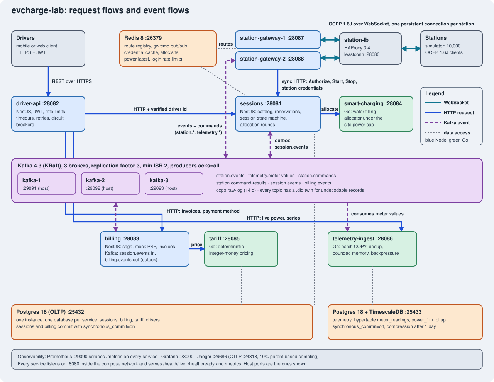

<h1 align="center">evcharge-lab</h1>

<p align="center">
  <b>The charge point operator side of an EV charging platform, built as a system-design lab.</b><br>
  Hold thousands of station WebSockets, take reservations without double-booking, split a site power cap, bill exactly once, absorb telemetry bursts.
</p>

<p align="center">
  <a href="https://github.com/sotream/evcharge-lab/actions/workflows/ci.yml"></a>
  <a href="https://github.com/sotream/evcharge-lab/actions/workflows/images.yml"></a>
  <a href="LICENSE"></a>
  
  
  
  
  
  
  
  
  
  
</p>

<p align="center">
  <a href="#architecture">Architecture</a> &middot;
  <a href="#5-minute-quick-start">Quick start</a> &middot;
  <a href="#the-system-design-question-each-service-answers">Services</a> &middot;
  <a href="#distributed-systems-guarantees">Guarantees</a> &middot;
  <a href="#results">Results</a> &middot;
  <a href="#drills">Drills</a> &middot;
  <a href="#what-the-drills-and-reviews-caught">Findings</a> &middot;
  <a href="#known-limits-and-production-gaps">Known limits</a> &middot;
  <a href="docs/adr/README.md">ADRs</a> &middot;
  <a href="docs/runbook.md">Runbook</a>
</p>

> **Status:** a learning and design lab, not a production system. Its known gaps are listed in [Known limits](#known-limits-and-production-gaps).

<!-- stats:start -->
| 7 services | 21 ADRs | 12 drill scripts | 19 of 20 drills pass on the latest run | 23 of 23 findings fixed |
|:---:|:---:|:---:|:---:|:---:|
| [NestJS and Go, plus a station simulator](#the-system-design-question-each-service-answers) | [one decision per file](docs/adr/README.md) | [failure drills](#drills) | [12 failed runs kept as evidence](docs/drills.md) | [found by drills, k6 and reviews](#what-the-drills-and-reviews-caught) |
<!-- stats:end -->

## Architecture

evcharge-lab is the charge point operator (CPO) side of an EV charging platform, built as a system-design lab. Seven services (NestJS and Go) and an OCPP 1.6J station simulator answer concrete questions: how to hold thousands of long-lived WebSockets across several instances, how to take reservations under contention without double-booking, how to split a hard site power cap fairly and safely, how to get an exactly-once billing effect out of at-least-once delivery, and how to absorb a bursty telemetry stream. Every decision is written down in an [ADR](docs/adr/README.md) against explicit load targets ([ADR 0000](docs/adr/0000-requirements-and-capacity.md)). The numbers in the generated blocks of this README (the targets table, the charts, the drills table and the findings table) and in [`docs/metrics.md`](docs/metrics.md) and [`docs/drills.md`](docs/drills.md) are read from raw files in `docs/load-output/` and `docs/drill-output/` by a script, labelled as measured or derived, and the targets that were missed stay visible as missed. The prose in "What the drills and reviews caught" and "Known limits" also quotes numbers; those were observed during the build, and each one is labelled as measured (with its file), derived (with its formula), observed but not saved as a file, or a review scenario.



Solid blue lines are synchronous HTTP requests, dashed purple lines are asynchronous Kafka event flows, thick teal lines are the station WebSockets, and dotted grey lines are data access. The decisions behind it are in [ADR 0001](docs/adr/0001-architecture-overview.md); the ports are in the same ADR and in [`docker-compose.yml`](docker-compose.yml).

## 5-minute quick start

Prerequisites: Docker with a VM of about 8 GB (the k6 runs below used 8 CPUs and 8.3 GB, the later drills 8 CPUs and 11.7 GiB; see the setup note), plus Node 26 and pnpm for `make check`. Go and `golangci-lint` are also required for `make check`, because it runs `go vet`, `golangci-lint run` and `go test -race` on the Go modules.

```sh
docker compose up -d --build      # infra, services, HAProxy, observability and the simulator
docker compose ps                 # infrastructure shows (healthy); the app services show Up (they have no healthcheck, see docs/runbook.md)
curl -s 127.0.0.1:28089/status    # simulator: connected stations, active sessions, queue depth
curl -s localhost:28081/health/ready   # any service: ports are listed below
```

By default the simulator connects 20 sites with 10 stations each (200 stations) and 50 simulated drivers, so sessions, meter values and allocation rounds start flowing immediately.

| What | URL | Notes |
|---|---|---|
| Driver API | http://localhost:28082 | the only public entry point; `POST /v1/auth/register`, then the routes in [its README](services/driver-api/README.md) |
| Station edge (OCPP) | ws://localhost:28080/ocpp/{stationId} | HAProxy `leastconn` in front of two gateway instances |
| HAProxy stats | http://localhost:28099 | backend health of the two gateways |
| Simulator control | http://127.0.0.1:28089/status | bound to localhost, unauthenticated |
| Grafana | http://localhost:23000 | anonymous viewer; Prometheus and Jaeger datasources and six dashboards in the `evcharge` folder are provisioned from [`infra/grafana/dashboards/`](infra/grafana/dashboards/): `overview` (the ADR 0000 SLOs, open it first), `gateway`, `sessions-allocation`, `billing`, `telemetry` and `kafka-and-infra` |
| Prometheus | http://localhost:29090 | queries used by the alerts in the [runbook](docs/runbook.md) |
| Jaeger | http://localhost:26686 | traces, 10% parent-based sampling |
| Services | `localhost:28081` sessions, `28083` billing, `28084` smart-charging, `28085` tariff, `28086` telemetry-ingest, `28087` and `28088` gateways | each serves `/health/live`, `/health/ready` and `/metrics` |

Run the full local check (lint, types, build, unit and integration tests, Go vet, lint and race tests):

```sh
make check
```

`make check` (through `make infra-up`) stops the application containers first, because the integration tests share Redis and Kafka with the stack; the infrastructure keeps running. Run `docker compose up -d` afterwards to bring the application containers back. `make down` stops everything and deletes the data. Operating notes and failure recipes are in the [runbook](docs/runbook.md).

## The system-design question each service answers

| Service | Language | System-design question | ADR |
|---|---|---|---|
| [`station-gateway`](services/station-gateway/README.md) | NestJS | How do you hold thousands of long-lived WebSockets across N instances and route a command to the one instance that owns a station? How do you survive reconnect storms and offline replay? | [0003](docs/adr/0003-ocpp-subset-station-auth-and-offline-replay.md), [0004](docs/adr/0004-websocket-connection-routing.md), [0012](docs/adr/0012-kafka-replication-and-producer-backpressure.md) |
| [`sessions`](services/sessions/README.md) | NestJS | How do you take reservations under contention without double-booking a connector? How do you run session state machines driven by unreliable station messages? | [0005](docs/adr/0005-reservation-contention.md) |
| [`smart-charging`](services/smart-charging/README.md) | Go | How do you split a hard site cap across sessions fairly, fast and safely, and what happens when the allocator is down? | [0006](docs/adr/0006-smart-charging-allocation.md) |
| [`tariff`](services/tariff/README.md) | Go | How do you price a session deterministically (integer money, time-of-use boundaries, rounding)? | [0011](docs/adr/0011-tariff-model.md) |
| [`billing`](services/billing/README.md) | NestJS | How do you get an exactly-once *effect* (one invoice, one capture) out of at-least-once delivery, and how do you compensate across services? | [0007](docs/adr/0007-billing-saga-and-exactly-once-effect.md) |
| [`telemetry-ingest`](services/telemetry-ingest/README.md) | Go | How do you absorb a high, bursty write rate of meter values with dedup and bounded memory? | [0008](docs/adr/0008-telemetry-storage.md), [0012](docs/adr/0012-kafka-replication-and-producer-backpressure.md) |
| [`driver-api`](services/driver-api/README.md) | NestJS | How do you authenticate drivers and compose calls to downstream services with timeouts, retries and idempotency? | [0010](docs/adr/0010-authentication.md) |
| [`simulator`](simulator/README.md) | Node | How do you produce realistic load from thousands of stations, including floods, offline periods and replays? | [0003](docs/adr/0003-ocpp-subset-station-auth-and-offline-replay.md), [0013](docs/adr/0013-traffic-generators-simulator-and-backfill.md) |

Cross-cutting decisions: [0000](docs/adr/0000-requirements-and-capacity.md) requirements, load model and SLOs; [0001](docs/adr/0001-architecture-overview.md) architecture; [0002](docs/adr/0002-contracts-events-and-delivery-semantics.md) contracts, event envelope and at-least-once plus idempotency; [0009](docs/adr/0009-toolchain-and-infrastructure-choices.md) toolchain and versions; [0012](docs/adr/0012-kafka-replication-and-producer-backpressure.md) Kafka replication and backpressure.

## Distributed-systems guarantees

- [ADR 0012](docs/adr/0012-kafka-replication-and-producer-backpressure.md): Kafka replication, producer durability and gateway backpressure. Drills: [`kafka-broker-loss.sh`](drills/kafka-broker-loss.sh) with one and two brokers down.
- [ADR 0015](docs/adr/0015-read-replica-and-read-your-writes-for-sessions.md): the sessions read replica and read-your-writes by LSN. Drill: [`replica-lag.sh`](drills/replica-lag.sh), run `replica-lag-20261108T183638Z` (11 of 11 checks): the replica was held back for 240 s, peak lag 239.4 s and drained 9 s after release; 0 read-your-writes violations in 624 checks; reads of a driver's own writes fell back to the primary after the 200 ms wait; driver API read p99 0.173 s during the pause (target < 0.3 s). Two earlier runs are kept with notes.
- [ADR 0016](docs/adr/0016-consensus-kraft-quorum.md): the KRaft controller quorum, quorum maths, and what losing the quorum does. Drill: [`kraft-quorum-loss.sh`](drills/kraft-quorum-loss.sh), run `kraft-quorum-loss-20261108T185039Z` (12 of 12 checks) with 2 of 3 nodes stopped for about 165 s (18:51:44Z to 18:54:29Z, `events.log`): 200 of 200 stations stayed connected, 0 RemoteStopTransaction sent, quorum back in 4 s, first acknowledged produce after 8 s, 0 of 393 probe readings missing (178 generated during this run, 117 while the nodes were down; the rest are left over from run T184440Z). Targets missed during the outage: OCPP CALLRESULT p99 reached 2.48 s (target < 0.5 s) and telemetry ingest lag p99 29.9 s during and 59.2 s after (target < 5 s).
- [ADR 0017](docs/adr/0017-consistency-models.md): the consistency model, mechanism and staleness bound of every piece of state.
- [ADR 0018](docs/adr/0018-postgres-failover-and-backup-restore.md): Postgres failover and backup/restore, async against sync (Apple M4 Pro, one run per row). Drills: [`postgres-failover.sh`](drills/postgres-failover.sh), [`backup-restore.sh`](drills/backup-restore.sh). The replica promotes and the services reconnect in 0.37 to 0.48 s (DB RTO), but drivers see 1.1 to 10.3 s consistent with the driver-api circuit breaker (openMs 10 s) opening; the breaker state was not recorded. **RPO 0 is not met with the asynchronous replica:** when the replica was cut off for 3 s before the primary was killed, 282 and 281 acknowledged writes were lost in two runs (probe commits over 3.1 s); the rerun also lost 10 acknowledged reservations and left 32 overlapping pairs of acknowledgements, each with a lost reservation on one side. With a synchronous standby the same fault lost 0, at the price of a 3.64 s write gap. Backup: 163,044 KiB (159 MiB) in 1.07 s, restored into a separate container in 2.10 s, all 10 checks passed (readiness plus 9 integrity checks), data age 52.7 s (no WAL archiving, so nothing after the backup comes back).
- [ADR 0019](docs/adr/0019-invariant-checking-under-faults.md): the reservation invariant checked from an operation history ([`load/history/`](load/history/), unit-tested) under a sessions pause (15 s), a sessions restart and a primary failover. Passed under the pause and the restart; failed (10 lost acknowledged reservations, 32 overlapping pairs each with a lost reservation on one side) in the async failover with an unreachable replica; with the constraint switched off the checker reports 292 violations in 883 operations. It is not a linearizability check; the ADR says what it does not prove.
- Consumer group rebalance ([ADR 0012](docs/adr/0012-kafka-replication-and-producer-backpressure.md), [`consumer-rebalance.sh`](drills/consumer-rebalance.sh)): a killed member is dropped after 45.1 and 45.3 s (two runs), the survivor owns all 24 partitions after 46.2 and 46.4 s, a restarted member is back in 0.2 to 0.4 s, the lag peak is 371 and 409 records, 0 readings lost. Offsets moved back by 200 records per partition: 4,800 records were read again and all 4,800 were suppressed by the unique index (0 duplicate rows).
- Load from another machine: [`load/run-remote.sh`](load/run-remote.sh) (see the runbook). Not run yet; remote numbers will be kept apart from local ones.
- 24 h station offline replay at simulator time scale 60 (`station-offline-replay-20261108T190213Z`, 20 stations offline for 1,440 simulated minutes): replay queues empty 40 s after the after phase began (about 49 s after the offline window ended; the reconnect time itself is not recorded), 123,652 probe readings generated, 0 missing, 0 duplicate rows. The replayed-row flag is not checked at time scale 60. The earlier INCONCLUSIVE run (151006Z) is kept.
- Other drills in [`drills/`](drills/): gateway instance loss, reconnect storm, slow Postgres, smart-charging down. Raw output is in `docs/drill-output/`.

## Results

The lab measures **one instance per service** on one machine, with all containers sharing one Docker VM, and derives the fleet size from it. The targets come from [`load/targets.json`](load/targets.json), which is transcribed from [ADR 0000](docs/adr/0000-requirements-and-capacity.md). Every verdict compares the measured value with the target with no tolerance, except the ADR 0000 rate rule for k6 throughput (within 0.1%, no dropped iteration, no failed request), so a missed target stays visible as missed. The machines are named in the setup note below.

<details>
<summary>Measurement setup</summary>

[ADR 0000](docs/adr/0000-requirements-and-capacity.md) names a MacBook Air M1 as the intended machine. The raw files record two different setups, and they are not mixed into one series:

- **k6 runs and benches of the earlier stages** (`docs/load-output/k6-*.env.json`): `darwin/arm64`, a Docker VM with 8 CPUs and 8.3 GB of memory (8,319,705,088 bytes), and the containers running during each run. None of these files records the laptop model, so which machine took them is not provable from the repository. `load/run.sh` now records it (`host.model`, `host.cpus`), but no k6 run has been repeated with it.
- **23 drill runs** (every drill from `replica-lag` on: `replica-lag`, `kraft-quorum-loss`, the 24 h `station-offline-replay` of 20261108T190213Z, `consumer-rebalance`, `postgres-failover`, `backup-restore`, `reservation-invariant`): an Apple M4 Pro (Mac16,8; 12 CPUs, 24 GiB) with a Docker VM of 8 CPUs and 11.7 GiB (12,526,571,520 bytes), recorded in each `env.json`.
- **14 older drill runs** (`gateway-instance-loss`, `kafka-broker-loss`, `reconnect-storm`, `slow-postgres`, `smart-charging-down` and the first two `station-offline-replay` runs) have no `env.json`; the machine is not recorded.

The targets come from [`load/targets.json`](load/targets.json), which is transcribed from ADR 0000.

</details>

### Targets at a glance

One row per target in `load/targets.json`. The full metrics table, with every row, label, source file, formula and note, is in [`docs/metrics.md`](docs/metrics.md).

<!-- glance:start -->
| Service | Metric | Target | Measured | Verdict | Source |
|---|---|---|---|---|---|
| station-gateway | WebSocket connections | ≥ 10,000 | 10,000 | ✅ met | [`gateway-10k-connections.json`](docs/load-output/gateway-10k-connections.json) |
| station-gateway | Messages per second | ≥ 2,000 /s | 1,139.03 /s | ❌ missed | [`k6-gateway-ws-2000st-1hz.json`](docs/load-output/k6-gateway-ws-2000st-1hz.json) |
| station-gateway | CALLRESULT p99 | ≤ 500 ms | 3,228 ms | ❌ missed | [`k6-gateway-ws-2000st-1hz.json`](docs/load-output/k6-gateway-ws-2000st-1hz.json) |
| telemetry-ingest | Sustained rows per second (2,500 offered) | ≥ 2,500 /s | 2,471.23 /s | ❌ missed | [`telemetry-ingestbench.json`](docs/load-output/telemetry-ingestbench.json) |
| telemetry-ingest | Durable lag p99 (at the target rate) | ≤ 5,000 ms | 942.95 ms | ✅ met | [`telemetry-ingestbench.json`](docs/load-output/telemetry-ingestbench.json) |
| telemetry-ingest | Telemetry visible in driver-api p99 | ≤ 10,000 ms | no measurement | not tested | no saved run |
| telemetry-ingest | Loss ratio at the target rate | ≤ 0.0001 | 0 | ✅ met | [`telemetry-ingestbench.json`](docs/load-output/telemetry-ingestbench.json) |
| sessions | Commands per second (StartTransaction + StopTransaction) | ≥ 200 /s | 199.99 /s | ✅ met (rate rule) | [`k6-sessions-ocpp-rate200.json`](docs/load-output/k6-sessions-ocpp-rate200.json) |
| smart-charging | Allocations per second (k6, service) | ≥ 1,000 /s | 999.97 /s | ✅ met (rate rule) | [`k6-smart-charging.json`](docs/load-output/k6-smart-charging.json) |
| smart-charging | Allocation p99 (open loop at the target rate) | ≤ 20 ms | 19.45 ms | ✅ met | [`smart-charging-allocbench.json`](docs/load-output/smart-charging-allocbench.json) |
| tariff | Quotes per second (k6, service) | ≥ 2,000 /s | 1,999.97 /s | ✅ met (rate rule) | [`k6-tariff.json`](docs/load-output/k6-tariff.json) |
| tariff | Quote p99 (open loop at the target rate) | ≤ 20 ms | 13.9 ms | ✅ met | [`tariff-quotebench-openloop.json`](docs/load-output/tariff-quotebench-openloop.json) |
| driver-api | Read requests per second (GET /v1/sites) | ≥ 1,000 /s | 955.59 /s | ❌ missed | [`k6-driver-api-reads.json`](docs/load-output/k6-driver-api-reads.json) |
| driver-api | Read p99 | ≤ 300 ms | 255.2 ms | ✅ met | [`k6-driver-api-reads.json`](docs/load-output/k6-driver-api-reads.json) |
| driver-api | Write p99 | ≤ 800 ms | no measurement | not tested | no saved run |
<!-- glance:end -->

How to read it: every verdict compares the measured value with the target, with no tolerance except the [ADR 0000](docs/adr/0000-requirements-and-capacity.md#lab-targets-one-instance-macbook-air-m1-docker-compose) rate rule for k6 throughput. The **station gateway misses its message-rate and CALLRESULT p99 targets** in the 2,000-station run, which is the only run that offers enough load to test the rate (see [Known limits](#known-limits-and-production-gaps)); the 1,000-station run cannot test a 2,000 msg/s target and is labelled "not tested", but it also missed the CALLRESULT p99 target (1,446 ms against 500 ms, `ocpp_callresult_ms` p(99) in `k6-gateway-ws-1000st-1hz.json`). The gateway does hold 10,000 WebSocket connections. The driver-api read rate (955.59 against 1,000) is a miss: 331 iterations were dropped. The sessions (199.99 against 200), smart-charging (999.97 against 1,000) and tariff (1,999.97 against 2,000) k6 rates are a fraction below their targets only because k6 divides by the whole run duration; those runs dropped no iteration and had no failed request, so they meet their targets under the rate rule and are marked "(rate rule)". The notes under the table in [`docs/metrics.md`](docs/metrics.md) explain each. The telemetry-ingest sustained rate at the target offered rate (2,471.23 against 2,500) is also a miss. The closed-loop saturation figures in the metrics table (for example 10,507.2 allocations/s and 14,399.8 quotes/s) are best-case benchmarks, not the charted verdicts.

### Charts

The chart shows each measured value divided by its target. Every chart is an SVG generated from the raw files by [`scripts/charts/`](scripts/charts/README.md) (`node scripts/charts/build.mjs`), works in GitHub light and dark themes, and carries a footer naming its source files and the measurement setup. The headline charts are below; the drill timelines are in [`docs/drills.md`](docs/drills.md) and the telemetry storage chart is in [`docs/metrics.md`](docs/metrics.md).

<!-- charts:start (generated by scripts/charts/build.mjs) -->
#### Target versus measured, per service

One bar per metric: the measured value divided by the target in `load/targets.json`. Bars are red where the measured value misses its target (ADR 0000, rate rule for k6 throughput): station-gateway: Messages per second; station-gateway: CALLRESULT p99; telemetry-ingest: Sustained rows per second (2,500 offered); driver-api: Read requests per second (GET /v1/sites).


#### Throughput and p99 per service

Achieved rate and p99 latency from the k6 summaries.


#### sessions: latency versus offered rate

4 constant-arrival-rate runs against `sessions`.


#### WebSocket connections per gateway instance

The 10,000-connection run (one native gateway process) and the k6 runs against one gateway container.


#### telemetry-ingest: COPY versus row-by-row

Sustained rate and durable lag against the offered rate. Hollow markers did not keep up.


#### smart-charging: allocation under the site cap

Drawn power against the sum of the site caps through the allocator outage drill, before, during and after.


<!-- charts:end -->

## Drills

The failure drills in [`drills/`](drills/) break one component while the simulator drives the fleet. Each run writes a timeline, an event log and a `result.json` with pass or fail checks to `docs/drill-output/`. Failed and inconclusive runs stay as evidence. [`docs/drills.md`](docs/drills.md) lists every run with its timeline chart; the findings the drills produced are in [What the drills and reviews caught](#what-the-drills-and-reviews-caught).

<!-- drills:start -->
| Drill | What it breaks | Runs passed | Latest run | Timeline |
|---|---|:---:|---|---|
| `backup-restore` | physical backup of the OLTP Postgres (all databases, so `sessions` and `billing`) with pg_basebackup, restored into a SEPARATE container, with integrity checks and a measured data age | 1 of 1 | ✅ passed | [20261108T215232Z](docs/drills.md#backup-restore-20261108t215232z) |
| `consumer-rebalance` | consumer-group rebalance under load, and idempotency on redelivery | 2 of 2 | ✅ passed | [20261108T214804Z](docs/drills.md#consumer-rebalance-20261108t214804z) |
| `gateway-instance-loss` | kill one station-gateway instance (SIGKILL, no graceful close) | 1 of 2 | ✅ passed | [20261108T122353Z](docs/drills.md#gateway-instance-loss-20261108t122353z) |
| `kafka-broker-loss-1` | one broker down | 1 of 2 | ✅ passed | [20261108T140530Z](docs/drills.md#kafka-broker-loss-1-20261108t140530z) |
| `kafka-broker-loss-2` | two brokers down | 1 of 2 | ✅ passed | [20261108T140952Z](docs/drills.md#kafka-broker-loss-2-20261108t140952z) |
| `kraft-quorum-loss` | lose the KRaft controller quorum (2 of 3 combined broker/controller nodes) under simulator load | 1 of 2 | ✅ passed | [20261108T185039Z](docs/drills.md#kraft-quorum-loss-20261108t185039z) |
| `postgres-failover-auto-async-stall0` | lose the OLTP primary and fail over to the streaming replica | 1 of 1 | ✅ passed | [20261108T203614Z](docs/drills.md#postgres-failover-auto-async-stall0-20261108t203614z) |
| `postgres-failover-auto-async-stall3` | lose the OLTP primary and fail over to the streaming replica | 0 of 2 | ❌ failed | [20261108T220826Z](docs/drills.md#postgres-failover-auto-async-stall3-20261108t220826z) |
| `postgres-failover-auto-sync-stall0` | lose the OLTP primary and fail over to the streaming replica | 1 of 1 | ✅ passed | [20261108T204337Z](docs/drills.md#postgres-failover-auto-sync-stall0-20261108t204337z) |
| `postgres-failover-auto-sync-stall3` | lose the OLTP primary and fail over to the streaming replica | 2 of 2 | ✅ passed | [20261108T221218Z](docs/drills.md#postgres-failover-auto-sync-stall3-20261108t221218z) |
| `postgres-failover-manual-async-stall0` | lose the OLTP primary and fail over to the streaming replica | 1 of 1 | ✅ passed | [20261108T215357Z](docs/drills.md#postgres-failover-manual-async-stall0-20261108t215357z) |
| `reconnect-storm` | whole fleet disconnects at once and reconnects per the ADR 0003 policy (first attempt U(0,10 s), then full-jitter backoff) | 1 of 1 | ✅ passed | [20261108T120311Z](docs/drills.md#reconnect-storm-20261108t120311z) |
| `replica-lag` | the sessions read replica stops replaying WAL (pg_wal_replay_pause) | 1 of 3 | ✅ passed | [20261108T183638Z](docs/drills.md#replica-lag-20261108t183638z) |
| `reservation-invariant-none` | the reservation invariant under faults, proved from an operation history | 1 of 1 | ✅ passed | [20261108T205643Z](docs/drills.md#reservation-invariant-none-20261108t205643z) |
| `reservation-invariant-none-mutated` | the reservation invariant under faults, proved from an operation history | 2 of 2 | ✅ passed | [20261109T090303Z](docs/drills.md#reservation-invariant-none-mutated-20261109t090303z) |
| `reservation-invariant-pause` | the reservation invariant under faults, proved from an operation history | 2 of 2 | ✅ passed | [20261109T090014Z](docs/drills.md#reservation-invariant-pause-20261109t090014z) |
| `reservation-invariant-restart` | the reservation invariant under faults, proved from an operation history | 2 of 2 | ✅ passed | [20261109T090135Z](docs/drills.md#reservation-invariant-restart-20261109t090135z) |
| `slow-postgres` | the telemetry Postgres becomes slow (CPU throttled to 0.05 cores) | 1 of 4 | ✅ passed | [20261108T162708Z](docs/drills.md#slow-postgres-20261108t162708z) |
| `smart-charging-down` | the Go allocator is down | 1 of 1 | ✅ passed | [20261108T114310Z](docs/drills.md#smart-charging-down-20261108t114310z) |
| `station-offline-replay` | stations lose their network for up to 24 h of simulated time while charging | 2 of 3 | ✅ passed | [20261108T190213Z](docs/drills.md#station-offline-replay-20261108t190213z) |
<!-- drills:end -->

## What the drills and reviews caught

Every item below was found during this build by a code review, a load test or a failure drill. Labels: **measured** means the number comes from a raw file in this repository (named) or a test assertion; **derived** means calculated from stated values with the formula given; **observed, not saved** means it was read from live `/metrics`, `free` or k6 output during a run and no file records it, so it cannot be reproduced from this repository; **review scenario** means a worked example from a review that was not measured on the running system.

<!-- findings:start -->
| # | Finding | Found by | Item |
|---:|---|---|---|
| 1 | Allocation command storm towards offline stations | k6 | [details](#finding-1) |
| 2 | Site cap exceeded during reallocation | review | [details](#finding-2) |
| 3 | Gateway safe share could exceed the cap, and one profile id was shared by all connectors | review | [details](#finding-3) |
| 4 | Invoices lost after a short Postgres outage | review | [details](#finding-4) |
| 5 | The outbox broke per-key event order with two replicas | review | [details](#finding-5) |
| 6 | <code>NOTIFY</code> serialised every commit | k6 | [details](#finding-6) |
| 7 | Concurrent <code>StartTransaction</code> on one connector returned 500 | k6 | [details](#finding-7) |
| 8 | <code>/v1/sites</code> returned 429,276 bytes per call | k6 | [details](#finding-8) |
| 9 | Memory pressure in the lab VM | k6 | [details](#finding-9) |
| 10 | Fleet convention drift between generators | review | [details](#finding-10) |
| 11 | Billing under-collected totals above the hold and could strand a charge | review | [details](#finding-11) |
| 12 | One bad telemetry row stopped ingest globally | review | [details](#finding-12) |
| 13 | A builder agent reported "committed" while its review fixes were still uncommitted | manual check | [details](#finding-13) |
| 14 | A late duplicate connect attempt left one station stuck after a gateway loss | drill | [details](#finding-14) |
| 15 | The gateway crashed with two Kafka brokers down | drill | [details](#finding-15) |
| 16 | OCPP deduplication returned another message's stored response after a simulator restart | drill | [details](#finding-16) |
| 17 | The first station-offline-replay run was invalid and still passed | drill | [details](#finding-17) |
| 18 | The drill harness wrote curl's "000" as a number and produced invalid JSON | drill | [details](#finding-18) |
| 19 | Allocation feedback loop: one SetChargingProfile result caused a round that resent every profile | drill | [details](#finding-19) |
| 20 | HAProxy kept stale gateway IPs | drill | [details](#finding-20) |
| 21 | The slow-Postgres drill never lifted its CPU cap | drill | [details](#finding-21) |
| 22 | Unbounded Jaeger memory | manual check | [details](#finding-22) |
| 23 | The first slow-Postgres failures were a Kafka leader move and an overloaded VM, not the slow database | drill | [details](#finding-23) |
<!-- findings:end -->

<details id="finding-1">
<summary>1. Allocation command storm towards offline stations</summary>

- **Found by:** a k6 sessions run with the simulator stopped.
- **Symptom (observed, not saved as a file):** 22,190 `SetChargingProfile` commands published and 3,144 trigger rounds within minutes while the stations were offline; Kafka sat at about 128% CPU per broker.
- **Cause:** every non-Accepted profile result (`StationOffline`, `Timeout`) re-triggered the site's round, which re-sent the same profiles.
- **Fix:** only Accepted results re-trigger. Other outcomes wait for the periodic 60 s round.
- **Regression test:** [`services/sessions/test/int/two-phase.test.ts`](services/sessions/test/int/two-phase.test.ts) (the assertion carries the comment "A non-Accepted result must not re-trigger the site"; that comment is not a test name).

</details>

<details id="finding-2">
<summary>2. Site cap exceeded during reallocation</summary>

- **Found by:** the Opus review of `sessions`.
- **Symptom (review scenario, not measured):** cap 30 kW, station A at 22 kW. A round gives A and B 15 kW each, A's decrease is lost because the station is offline, and B's increase lands: 37 kW in force.
- **Cause:** decreases and increases were sent together, on different partitions, with no ordering; a non-Accepted result also nulled the stored limit.
- **Fix:** two-phase apply. The in-force limit is tracked, increases are sent only when the headroom covers the worst case, and an unconfirmed profile is never forgotten ([ADR 0006](docs/adr/0006-smart-charging-allocation.md), "Applying an allocation").
- **Regression test:** [`services/sessions/test/int/two-phase.test.ts`](services/sessions/test/int/two-phase.test.ts).

</details>

<details id="finding-3">
<summary>3. Gateway safe share could exceed the cap, and one profile id was shared by all connectors</summary>

- **Found by:** the Opus review of the gateway.
- **Symptom (review scenario, not measured):** cap 30 kW and 3 connectors with a safe share of 10 kW. A is at 20 kW, B is raised to 10 kW, C is at its start power of 4.14 kW: 34.1 kW. Separately, connector 2's profile replaced connector 1's.
- **Cause:** the safe share was raised per connector instead of per site, and every connector used the same profile id.
- **Fix:** one profile id per connector, `txProfileId(c) = 100 + c`, and the safe share is applied only when the whole site is stale (Redis key `alloc:site:{id}`, written by `sessions` before each round commits).
- **Regression tests:** [`services/station-gateway/test/int/gateway.int.test.ts`](services/station-gateway/test/int/gateway.int.test.ts), [`simulator/test/unit/profiles.test.ts`](simulator/test/unit/profiles.test.ts).

</details>

<details id="finding-4">
<summary>4. Invoices lost after a short Postgres outage</summary>

- **Found by:** the Opus review of `billing`.
- **Symptom (review scenario; derived from the consumer defaults: 5 attempts with full-jitter backoff capped at 200, 400, 800 and 1,600 ms, so at most about 3 s in total and about 1.5 s on average):** a Postgres blip of a few seconds dead-lettered `session.completed`, and no invoice was ever issued.
- **Cause:** handler errors were retried only a few times before the record went to the dead-letter topic.
- **Fix:** the platform consumer retries handler errors indefinitely and dead-letters only undecodable records.
- **Regression test:** [`services/billing/test/int/outage.test.ts`](services/billing/test/int/outage.test.ts) (about 10 s with connections refused; the invoice is still issued and the DLQ stays empty).

</details>

<details id="finding-5">
<summary>5. The outbox broke per-key event order with two replicas</summary>

- **Found by:** the ponytail audit, confirmed by the Opus review.
- **Symptom (review scenario, not measured):** with two replicas, events for one key could be published out of order.
- **Cause:** every replica ran a `SKIP LOCKED` relay, and `bigserial` ids are allocated before commit.
- **Fix:** a single active relay per database (advisory lock) that publishes rows whose transaction finished before every running one, ordered by `(tx, id)` ([ADR 0002](docs/adr/0002-contracts-events-and-delivery-semantics.md) erratum).
- **Regression test:** [`packages/platform/test/int/outbox.test.ts`](packages/platform/test/int/outbox.test.ts) ("does not publish a later-committed row before an earlier-started one", "a second relay is a no-op").

</details>

<details id="finding-6">
<summary>6. <code>NOTIFY</code> serialised every commit</summary>

- **Found by:** a k6 sessions run, then traces and `pg_stat_activity`.
- **Symptom (observed, not saved as a file):** `COMMIT` waiting on `Lock:object`, connection pool exhaustion ("timeout exceeded when trying to connect"), and the OCPP hot path at multi-second p99.
- **Cause:** the outbox `AFTER INSERT` trigger ran `pg_notify`. Postgres takes one global lock at commit for every notifying transaction and holds it across the WAL flush.
- **Fix:** no trigger; the relay polls every 50 ms. Migration `0004_outbox_drop_notify.sql` in [`sessions`](services/sessions/migrations/0004_outbox_drop_notify.sql) and [`billing`](services/billing/migrations/0004_outbox_drop_notify.sql).
- **Regression test:** [`packages/platform/test/int/outbox.test.ts`](packages/platform/test/int/outbox.test.ts) (asserts that there is no trigger and that publication happens within 1 s).

</details>

<details id="finding-7">
<summary>7. Concurrent <code>StartTransaction</code> on one connector returned 500</summary>

- **Found by:** a k6 sessions run. The error (unique violation `active_sessions_connector_pk_key`) was observed in the k6 output and not saved as a file.
- **Cause:** two transactions raced to insert the active session of one connector.
- **Fix:** `SELECT ... FOR NO KEY UPDATE OF c` on the connector row.
- **Regression test:** [`services/sessions/test/int/ocpp.test.ts`](services/sessions/test/int/ocpp.test.ts) ("concurrent StartTransactions on one connector").

</details>

<details id="finding-8">
<summary>8. <code>/v1/sites</code> returned 429,276 bytes per call</summary>

- **Found by:** the k6 driver-api run.
- **Symptom (observed, not saved as a file):** 429,276 bytes per call for 146 sites and 1,460 stations, which capped driver-api reads at about 527 RPS.
- **Fix:** the nearest 20 sites by default (limit up to 100). Afterwards the saved run ([`k6-driver-api-reads.json`](docs/load-output/k6-driver-api-reads.json), measured) reached 955.59 req/s (`http_reqs` rate) at p99 255.2 ms against 1,000 req/s offered. The rate is a **miss** against the 1,000 req/s target, and the p99 passes (target 300 ms). `http_reqs` includes 40 setup requests, and the scenario iterations ran at about 994.5 per second [derived: 59,669 iterations / 60 s], with 331 of 60,000 iterations dropped. The 1% dropped-iteration tolerance belongs to the k6 script; ADR 0000 does not define it.
- **Regression test:** none; the load script [`load/k6/driver-api-reads.js`](load/k6/driver-api-reads.js) is the guard.

</details>

<details id="finding-9">
<summary>9. Memory pressure in the lab VM</summary>

- **Found by:** k6 results that degraded over time.
- **Symptom (observed with `free` in a container, not saved as a file):** swap at 1,023 MB with 1.3 MB free, the Jaeger in-memory store at 1.15 GB with 100% sampling, and Kafka GC at about 150% CPU per broker.
- **Fix:** 10% parent-based trace sampling, documented in [`docker-compose.yml`](docker-compose.yml). That was not enough; see item 22 for the bounded Jaeger store.
- **Regression test:** none; it is a configuration change.

</details>

<details id="finding-10">
<summary>10. Fleet convention drift between generators</summary>

- **Found by:** the Opus review.
- **Symptom (review scenario, not measured):** `sessions`, the simulator and the backfill each had their own DC power rule (for example station g=24 was 50 kW in one and 150 kW in another).
- **Fix:** one convention in [`packages/contracts/src/fleet.ts`](packages/contracts/src/fleet.ts) with a generated fixture.
- **Regression tests:** `TestFleetFixture` in [`scripts/backfill-telemetry/internal/gen/`](scripts/backfill-telemetry/internal/gen/) and the simulator fleet test [`simulator/test/unit/fleet-demand.test.ts`](simulator/test/unit/fleet-demand.test.ts).

</details>

<details id="finding-11">
<summary>11. Billing under-collected totals above the hold and could strand a charge</summary>

- **Found by:** the Opus review.
- **Symptom (review scenario, not measured):** invoice totals above the authorized hold were under-collected, and a charge could be stranded when the card changed in the middle of a retry.
- **Fix:** the remainder is captured with the idempotency key `capture:{invoiceId}:rest`, and the exact capture request is persisted and replayed.
- **Regression test:** [`services/billing/test/int/psp-edge.test.ts`](services/billing/test/int/psp-edge.test.ts).

</details>

<details id="finding-12">
<summary>12. One bad telemetry row stopped ingest globally</summary>

- **Found by:** the Opus review.
- **Symptom (review scenario, not measured):** one bad row stopped ingest for everything.
- **Fix:** bisect the failed batch and dead-letter only the rejected record.
- **Regression test:** `TestPoisonRecordIsBisectedAndDeadLettered` in [`services/telemetry-ingest/internal/ingest/pipeline_integration_test.go`](services/telemetry-ingest/internal/ingest/pipeline_integration_test.go).

</details>

<details id="finding-13">
<summary>13. A builder agent reported "committed" while its review fixes were still uncommitted</summary>

- **Found by:** checking the running compose stack (the rate limits were missing from the container environment).
- **Process fix:** every worktree is verified clean before it is merged.
- **Regression test:** none; it is a process rule.

</details>

<details id="finding-14">
<summary>14. A late duplicate connect attempt left one station stuck after a gateway loss</summary>

- **Found by:** the gateway-instance-loss drill, first run ([`gateway-instance-loss-20261108T115832Z`](docs/drill-output/gateway-instance-loss-20261108T115832Z/result.json), **FAILED**, kept as evidence).
- **Symptom (measured, `result.json`):** 199 of 200 stations reconnected (`routes_present_after_loss` 199, `fleet_connected_after_recovery` 199, and no measurement for `stations_reconnected_within_s`).
- **Cause:** a late duplicate connect attempt completed on the server after the current one, and the gateway replaced the current socket with close code 4000. The simulator then stopped reconnecting.
- **Fix:** the simulator closes superseded sockets when they open and reconnects after a 10 to 30 s pause on close code 4000.
- **Tests:** the simulator unit tests, and the drill itself. The rerun ([`gateway-instance-loss-20261108T122353Z`](docs/drill-output/gateway-instance-loss-20261108T122353Z/result.json), passed, measured) reconnected in 31 s with 200 of 200 routes.

</details>

<details id="finding-15">
<summary>15. The gateway crashed with two Kafka brokers down</summary>

- **Found by:** the kafka-broker-loss drill with two brokers, first run ([`kafka-broker-loss-2-20261108T123144Z`](docs/drill-output/kafka-broker-loss-2-20261108T123144Z/result.json), **FAILED**, kept as evidence with a [`NOTE.md`](docs/drill-output/kafka-broker-loss-2-20261108T123144Z/NOTE.md)).
- **Symptom (measured, `result.json`):** `gateway_ready_during_outage` got no HTTP answer (recorded as 0, expected 200), and 126 of 280 probe readings were missing. The produce error rate and the buffer depth checks passed (34.79 errors/s at most, buffer depth 549).
- **Cause:** the `@platformatic/kafka` consumer client emitted an unhandled `error` event ("joinGroup failed 4 times"), which crashed the process, and the restart then blocked on joining the group.
- **Fix:** the platform consumer handles client errors, rebuilds the client, and joins in the background, so `start()` no longer blocks the service.
- **Regression test:** [`packages/platform/test/int/kafka.test.ts`](packages/platform/test/int/kafka.test.ts) ("kafka consumer without reachable brokers"). The three stations stuck before the outage (item 16) explain at most 84 of the 126 missing readings [derived: 3 × 28 readings per probe station in `probes/readings.csv`]; the remaining 42 have no named cause and are not isolated.

</details>

<details id="finding-16">
<summary>16. OCPP deduplication returned another message's stored response after a simulator restart</summary>

- **Found by:** the kafka-broker-loss drill with one broker, first run ([`kafka-broker-loss-1-20261108T122708Z`](docs/drill-output/kafka-broker-loss-1-20261108T122708Z/result.json), **FAILED**, kept with a [`NOTE.md`](docs/drill-output/kafka-broker-loss-1-20261108T122708Z/NOTE.md)).
- **Symptom (measured, `result.json`):** 30 of 100 probe readings were missing. All of them belonged to three stations that were stuck before the outage.
- **Cause:** `sessions` deduplicated OCPP messages on `stationId:uniqueId`. After a simulator restart the uniqueId counters restarted, so a new `StartTransaction` received the stored response of an old message, which had no `transactionId`, and the station retried forever.
- **Fix:** deduplicate on uniqueId, action and payload hash (`messageKey` in [`services/sessions/src/ocpp/ocpp.service.ts`](services/sessions/src/ocpp/ocpp.service.ts)), and give the simulator boot-prefixed message ids.
- **Regression test:** [`services/sessions/test/int/ocpp.test.ts`](services/sessions/test/int/ocpp.test.ts) ("uniqueId reuse after a firmware restart").

</details>

<details id="finding-17">
<summary>17. The first station-offline-replay run was invalid and still passed</summary>

- **Found by:** reading the first run of `drills/station-offline-replay.sh`.
- **Symptom:** `POST /offline` returned HTTP 400, so no station went offline, yet the drill passed. The run was deleted.
- **Fix:** the drill now checks that the stations really went offline (`stations_taken_offline`) and that the connected count dropped (`connected_dropped_during_offline`). The valid rerun ([`station-offline-replay-20261108T141434Z`](docs/drill-output/station-offline-replay-20261108T141434Z/result.json), passed, measured) simulated 10 minutes offline at time scale 1 with 20 stations: 31 s to drain the replay queues, 0 dropped queue entries, 0 of 1,272 probe readings missing, 0 duplicate rows, and 960 replayed rows flagged. The 24 h offline replay at time scale 60 ([`station-offline-replay-20261108T151006Z`](docs/drill-output/station-offline-replay-20261108T151006Z/result.json), **FAILED** and **inconclusive**, kept with a [`NOTE.md`](docs/drill-output/station-offline-replay-20261108T151006Z/NOTE.md)) did not show a loss. The replay queue was still draining (140,564 messages at its peak, 89,114 when the 600 s wait ended), and then the harness restored the simulator before the queue had drained, which discarded the remaining in-memory queue and produced the 82,914 "missing" readings. That is a harness bug. The rerun that waits for the queue to drain ([`station-offline-replay-20261108T190213Z`](docs/drill-output/station-offline-replay-20261108T190213Z/result.json), passed, measured) found 0 missing readings and 0 duplicates across 123,652 probe readings.

</details>

<details id="finding-18">
<summary>18. The drill harness wrote curl's "000" as a number and produced invalid JSON</summary>

- **Found by:** the `result.json` of the two-broker drill (item 15), which contained `"measured":000`.
- **Fix:** the harness now normalises every check value. In the kept two-broker run that one token was changed to `0` by hand so that the file parses (stated in its `NOTE.md`). The chart generator also skips and reports any malformed `result.json` instead of failing.

</details>

<details id="finding-19">
<summary>19. Allocation feedback loop: one SetChargingProfile result caused a round that resent every profile</summary>

- **Found by:** the failed slow-Postgres run ([`slow-postgres-20261108T142904Z`](docs/drill-output/slow-postgres-20261108T142904Z/result.json), **FAILED**, kept with a [`NOTE.md`](docs/drill-output/slow-postgres-20261108T142904Z/NOTE.md)), followed by the Prometheus metrics `sessions_charging_profiles_sent_total` and `outbox_published_total`.
- **Symptom (observed, not saved as a file):** about 140 SetChargingProfile/s published for a 20-site, 200-station fleet, with all three Kafka brokers at 140-160% CPU.
- **Cause, part 1:** every Accepted SetChargingProfile result immediately triggered a new round at the site.
- **Cause, part 2:** every round resent every session's profile at the site (the reason was site-level), so one change or one result cost one command per session.
- **Fix:** an Accepted result now makes the site due in 2 s (debounced, picked up by the tick) instead of kicking a round. Profiles are sent per session: new, changed by at least max(2%, 200 W), within 60 s of `validTo`, unconfirmed and last sent at least 30 s ago (retry), or all of them when the site is unsafe. See [ADR 0006](docs/adr/0006-smart-charging-allocation.md).
- **Result (observed via Prometheus, not saved as a file):** about 3 profiles/s in total (changed 1.49, refresh 1.15, retry 0.37, new 0.04).
- **Regression tests:** [`services/sessions/test/unit/plan.test.ts`](services/sessions/test/unit/plan.test.ts) ("re-sends only the session that changed", "retries an unconfirmed profile ... 30 s") and [`services/sessions/test/int/two-phase.test.ts`](services/sessions/test/int/two-phase.test.ts).

</details>

<details id="finding-20">
<summary>20. HAProxy kept stale gateway IPs</summary>

- **Found by:** three drill reruns that ran with 0 of 200 stations connected. They were invalid and were deleted.
- **Cause:** HAProxy resolved `station-gateway-1` and `station-gateway-2` only at startup. Recreated gateway containers got new IPs, so every upgrade got 503.
- **Fix:** `resolvers docker` (127.0.0.11) with `init-addr libc,none` in [`infra/haproxy/haproxy.cfg`](infra/haproxy/haproxy.cfg). Every drill now calls `require_fleet` and aborts if the fleet is not fully connected. See [ADR 0004](docs/adr/0004-websocket-connection-routing.md) and the [runbook](docs/runbook.md).
- **Regression test:** none; the guard is the `require_fleet` check in the drills.

</details>

<details id="finding-21">
<summary>21. The slow-Postgres drill never lifted its CPU cap</summary>

- **Found by:** the notes of the two failed Kafka runs ([`kafka-broker-loss-1-20261108T122708Z`](docs/drill-output/kafka-broker-loss-1-20261108T122708Z/NOTE.md), [`kafka-broker-loss-2-20261108T123144Z`](docs/drill-output/kafka-broker-loss-2-20261108T123144Z/NOTE.md)), whose telemetry database was still capped.
- **Cause:** `docker update --cpus 0` does not remove a limit, so the telemetry Postgres stayed at 0.05 CPU after the drill. The affected slow-Postgres run was deleted, and the two failed Kafka runs carry a note.
- **Fix:** the drill restores the Docker VM CPU count. The telemetry postgres-exporter also skips per-table collectors.
- **Regression test:** none.

</details>

<details id="finding-22">
<summary>22. Unbounded Jaeger memory</summary>

- **Found by:** the failed slow-Postgres run again: Kafka itself was slow.
- **Symptom (observed, not saved as a file):** 864 MB even at 10% sampling, with swap full again. `kafka-producer-perf-test` with acks=all at 50 msg/s gave p50 493 ms and p99 1,230 ms (observed, not saved).
- **Fix:** a Jaeger v2 config, [`infra/jaeger/config.yaml`](infra/jaeger/config.yaml), with memory `max_traces` 20000, plus `mem_limit: 400m`. After a rolling Kafka restart the same producer test gave p50 14 ms and p99 295 ms at 50 msg/s (observed, not saved).
- **Regression test:** none; it is a configuration change.

</details>

<details id="finding-23">
<summary>23. The first slow-Postgres failures were a Kafka leader move and an overloaded VM, not the slow database</summary>

- **Found by:** a slow-Postgres run ([`slow-postgres-20261108T150304Z`](docs/drill-output/slow-postgres-20261108T150304Z/result.json), **FAILED** on one check, kept with a [`NOTE.md`](docs/drill-output/slow-postgres-20261108T150304Z/NOTE.md)).
- **What held (measured, `result.json` and `NOTE.md`):** ingest stalled and the backlog stayed in Kafka (peak consumer lag 133 records, below the 200-record threshold of `lag_drained_within_s`, so its value of 0 does not show a drain); the durable lag p99 was 1.37 s 90 s after recovery (target < 5 s); 0 of 2,103 probe readings were missing.
- **What failed (measured, `result.json` and `timeline.jsonl`):** the OCPP CALLRESULT p99 rose to the 10 s histogram cap during the slowdown (target 0.5 s), then fell to about 0.7 s afterwards. It was already above the target before the database was capped: 0.24-0.47 s until 15:03:44, then 0.84-0.85 s (maximum 0.849 s) from 15:03:45, before the 15:04:06 cap and the 15:04:31 leader move. That pre-fault rise is not isolated. Heartbeat, answered locally by the gateway, stayed at about 8 ms. Calls that wait for a Kafka ack and StopTransaction slowed together.
- **Cause (isolated afterwards from the broker and gateway logs, observed, not saved as a file; details in `NOTE.md`):** a Kafka preferred-leader rebalance (`auto.leader.rebalance.enable`, every 300 s) moved partition leadership at 15:04:31, 5 min after a rolling broker restart, and the gateway's in-flight produces hung for the full 30 s send timeout (50 x "kafka send timed out after 30000ms" in the gateway log, observed, not saved as a file), holding every Kafka-acked CALLRESULT. The slow database itself was not the cause.
- **Fix:** the gateway send timeout is now 3 s (`KAFKA_SEND_TIMEOUT_MS`); a hung produce fails fast with CALLERROR and the station retries the same uniqueId. This bounds the stall during a leader move at about 3 s; it does not meet the 500 ms SLO during the move.
- **Consequence:** the run stays a FAIL in the metrics table, as [ADR 0000](docs/adr/0000-requirements-and-capacity.md) requires. It does not show that a slow telemetry database hurts the OCPP path; it shows that a partition leader move does.
- **Clean rerun:** [`slow-postgres-20261108T162708Z`](docs/drill-output/slow-postgres-20261108T162708Z/NOTE.md) **PASSED**: it ran after a forced PREFERRED election and more than 5 min of waiting (both observed by hand, not saved in that run's `events.log`). CALLRESULT p99 was 0.076 s during the slowdown, durable lag 0.49 s 90 s after recovery, and 0 probe readings were missing (measured, `result.json`). At its default 30 s meter interval no Kafka backlog built up (peak consumer lag 0, 140 probe readings), so its `lag_drained_within_s` of 0 shows no drain, and the run does not confirm that a backlog leaves the OCPP path unaffected: both 2 s-meter runs that built a backlog failed the CALLRESULT check (150304Z with an isolated Kafka leader move, 160959Z on an overloaded VM). In 160959Z the CALLRESULT p99 was 2.48 s during the slowdown and the durable lag 9.9 s after recovery. A further run at 2 s meters ([`slow-postgres-20261108T160959Z`](docs/drill-output/slow-postgres-20261108T160959Z/NOTE.md)) was confounded by an overloaded VM and is kept with a note.
- **Isolated reproduction:** `load/repro/leader-move.sh` ([results](docs/load-output/leader-move-README.md)) shows the client stalling produces for up to 4.4 s on a leader move with its default retries, and about 1.3-1.9 s across the tuned runs (p99 1,317 and 1,387 ms, max 1,693 and 1,894 ms). The rest is recorded as a named library limitation in ADR 0012.

**Passing reruns.** [`kafka-broker-loss-1-20261108T140530Z`](docs/drill-output/kafka-broker-loss-1-20261108T140530Z/result.json) passed with 0 of 96 probe readings missing. [`kafka-broker-loss-2-20261108T140952Z`](docs/drill-output/kafka-broker-loss-2-20261108T140952Z/result.json) passed (measured): the gateway stayed live (HTTP 200 on `/health/live`), produce errors rose to 7.20/s at most, the buffer depth to 187 at most, and 0 of 254 probe readings were missing. The failed first runs stay as evidence with their notes. The gateway-instance-loss rerun passed with 31 s (item 14), and the station-offline-replay rerun passed (item 17).

**Runs before the fixes.** The reconnect-storm run ([`reconnect-storm-20261108T120311Z`](docs/drill-output/reconnect-storm-20261108T120311Z/timeline.jsonl)) shows at most 199 connected stations of 200 in its timeline (`sim_connected`). A slow-postgres run from the same period passed its checks, but it was deleted after item 21 showed that the CPU cap was never lifted; three of the later slow-Postgres runs (items 19 and 23: 142904Z, 150304Z, 160959Z) failed, and the fourth (162708Z, item 23) passed. The reconnect-storm run passed its checks.

</details>

## Known limits and production gaps

**The station gateway misses its per-instance target.** [ADR 0000](docs/adr/0000-requirements-and-capacity.md) asks for at least 10,000 connections and at least 2,000 msg/s with CALLRESULT p99 under 500 ms per instance. One gateway holds 10,000 connections at a peak RSS of 525 MB ([`gateway-10k-connections.json`](docs/load-output/gateway-10k-connections.json)). Under k6 load with the real `sessions` service behind it, it delivers 910.28 msg/s (1,000 stations) and 1,139.03 msg/s (2,000 stations) with p99 of 1,446 ms and 3,228 ms and zero CALLERRORs (measured, [`k6-gateway-ws-1000st-1hz.json`](docs/load-output/k6-gateway-ws-1000st-1hz.json) and [`k6-gateway-ws-2000st-1hz.json`](docs/load-output/k6-gateway-ws-2000st-1hz.json)). The 1,000-station run offers at most 1,000 msg/s (1 msg/s per station, one outstanding CALL each [derived]), so it cannot test the 2,000 msg/s target: its rate is **not tested**. Only the 2,000-station run tests the rate, and it **missed** at 1,139.03 msg/s. The CALLRESULT p99 target is **missed** in both runs. The target was recorded as measured and not lowered, as ADR 0000 requires.

- **Bottleneck ([ADR 0004](docs/adr/0004-websocket-connection-routing.md), measured amendment):** one Node.js core per instance. A single gateway process was observed at about 108% CPU during these runs (observed, not saved as a file; the saved 10,000-connection run is a different load, with `samples[].cpuPct` peaking at 110 in [`gateway-10k-connections.json`](docs/load-output/gateway-10k-connections.json)). Per message it does a JSON parse, zod validation, a Kafka produce with `acks=all` through a pure-JS client, and a second produce for the raw log.
- **Raw-log experiment (unreproducible, not used as evidence):** an earlier experiment reported 802 and 1,068 msg/s with the raw log on and off. No file was saved, and the figures are inconsistent with the kept 2,000-station run (1,139.03 msg/s with the raw log on). The effect of removing the second produce is not measured.
- **The fleet requirement is not demonstrated:** the 2,400 msg/s design peak spread over 5 surviving instances is 480 msg/s per instance [derived: 2,400 / 5]. No run measured the latency at 480 msg/s. The 910.28 msg/s run had no errors but missed the p99 target (1,446 ms against 500 ms).
- **Scaling path:** one gateway process per core (Node cluster or more replicas behind HAProxy; the registry already supports any number of instances), sampling or batching the raw log, and a precompiled validator instead of a per-frame zod parse.

**Other limits of the measurements**

- Everything is single-instance on one machine, and all containers share one Docker VM with the load generator (see the setup records: `docs/load-output/*.env.json` for k6, `docs/drill-output/*/env.json` for drills, and the setup note above for which machine and VM each series used). Absolute numbers are not production numbers; they show where each design stands against its own target.
- The sessions sweep is not monotone: at 150 commands/s the StartTransaction p99 was 621.77 ms, above the script's 500 ms threshold, while 200 commands/s passed with 177.39 ms. Each point is one 60 s run, and the cause of the 150/s outlier was not isolated.
- The smart-charging open-loop p99 of 19.45 ms ([`smart-charging-allocbench.json`](docs/load-output/smart-charging-allocbench.json), measured) is close to its 20 ms target.
- Gaps in the evidence: no saved run measures the driver-api write p99 (target 800 ms), the telemetry visible-in-driver-api p99 (target 10 s), the remote-start SLOs or the invoice-after-session-end p99. Those targets in `load/targets.json` have no measurement behind them yet.
- The full-fleet storage sizes are extrapolated from a 5,000-station, 7-day sample and are labelled derived. Compression and query numbers were measured with the background policy jobs paused and run manually (notes in `docs/load-output/telemetry-backfill-*.json`).
- Drill results in the metrics table and the drill charts are regenerated from `docs/drill-output/`; a failed check appears as FAIL.
- **Slow-Postgres:** the clean run (162708Z) passes (item 23), but it built no backlog (peak consumer lag 0). Earlier runs failed because of a coincident Kafka leader move (150304Z, with a pre-fault p99 rise that is not isolated) and an overloaded lab VM (160959Z), and are kept as evidence. A partition leader move still stalls the gateway's produces for about 1.3-1.9 s across the tuned runs (1.7 s at most with the shipped setting), a named limitation of `@platformatic/kafka` (ADR 0012).
- **Lab VM limit:** three Kafka JVM brokers on one 8 GB Docker VM (the VM of the earlier k6 runs) show 100-170% CPU per broker (observed, not saved as a file) even at low traffic once memory gets tight (GC). Rolling restarts recover them. Measurements taken in that state were discarded and rerun, so the saved runs should be read as taken on a healthy VM, not a tight one.
- **Drill checks changed after a failed run (disclosed in each `NOTE.md`):** in `kraft-quorum-loss` the baseline of the RemoteStop counter moved from before the Kafka stop to after the quorum loss was confirmed (the first run failed `remote_stop_sent_during_outage` because two commands were produced while the nodes were still shutting down). That check proves little by itself, because without Kafka commands cannot be produced anyway; it only shows that nothing leaked out during the outage. In `slow-postgres` the check `ingest_lag_p99_s_after_recovery` (118 s, FAIL) became `ingest_lag_p99_s_90s_after_recovery`, measured 90 s after recovery instead of over the minute in which the backlog drained. The clean run (162708Z) passes, but it built no backlog (peak consumer lag 0), as stated above. These changes were made after seeing the failures, so the passing runs are evidence that the fixed checks pass, not that the first ones would have.
- **Drills need a connected fleet:** every drill aborts through `require_fleet` unless all stations are connected, so a drill never reports on an empty fleet (item 20).
- **Jaeger keeps at most 20000 traces** in memory (`mem_limit` 400m), so old traces disappear under load.
- **24 h offline replay:** failed and inconclusive ([`station-offline-replay-20261108T151006Z`](docs/drill-output/station-offline-replay-20261108T151006Z/NOTE.md)). The 10-minute run at time scale 1 passed. In the 24 h run at time scale 60 the harness restored the simulator before the replay queue drained, so the result says nothing about loss. The rerun passed ([`station-offline-replay-20261108T190213Z`](docs/drill-output/station-offline-replay-20261108T190213Z/result.json): queues empty after 40 s, 0 dropped, 0 of 123,652 probe readings missing, 0 duplicate rows).
- NOT_ENOUGH_REPLICAS cannot be provoked on the compose Kafka cluster, so that path is covered by a unit test with a failing producer ([gateway README](services/station-gateway/README.md)). The two-broker drill therefore uses produce errors and buffer growth as its evidence, not the literal error code.
- The reconnect-storm drill disconnected 199 stations (`events.log` of the run; the default fleet has 200) and a warm Redis, not with the 833 connects/s of ADR 0003, and the billing service has no load measurement.

**Production gaps (lab simplifications, from the [runbook](docs/runbook.md) and the ADRs)**

- **Service authentication:** a shared internal token instead of mTLS ([ADR 0010](docs/adr/0010-authentication.md)).
- **Station security:** OCPP security profile 1 (Basic auth) instead of TLS client certificates ([ADR 0003](docs/adr/0003-ocpp-subset-station-auth-and-offline-replay.md)).
- **Durability:** one primary with an asynchronous replica. The failover drills ([ADR 0018](docs/adr/0018-postgres-failover-and-backup-restore.md)) measured that an asynchronous replica loses acknowledged commits when the primary dies, so RPO 0 holds only with a synchronous standby, which production needs.
- **Kafka:** combined broker and controller nodes; production would use dedicated controllers ([ADR 0012](docs/adr/0012-kafka-replication-and-producer-backpressure.md)).
- **Simulator control API:** unauthenticated, bound to 127.0.0.1 only.
- **PSP:** a mock. A real adapter must support idempotency keys and voiding by authorization key ([ADR 0007](docs/adr/0007-billing-saga-and-exactly-once-effect.md)).
- **Out of scope:** OCPI roaming, OCPP 2.0.1, ISO 15118, a real payment provider, multi-region active-active and grid or energy-market integration ([ADR 0000](docs/adr/0000-requirements-and-capacity.md)).

## Repo map

```
docs/
  adr/                 ADRs and the index: requirements, architecture, contracts, per-service decisions
  metrics.md           generated: the full metrics table
  drills.md            generated: every drill run with its timeline chart
  runbook.md           start, stop, signals worth alerting on, failure recipes, known gaps
  load-output/         raw k6 summaries (+ .env.json setup records) and tool outputs: the source of every measured number
  drill-output/        raw failure-drill output: timeline.jsonl, events.log, result.json per run
  img/                 architecture.svg (hand-made) and the generated charts
services/
  station-gateway/     NestJS: OCPP 1.6J WebSocket edge, routing, offline replay
  sessions/            NestJS: catalog, reservations, session state machine, allocation rounds
  billing/             NestJS: saga, mock PSP, invoices
  driver-api/          NestJS: driver authentication and the public API
  smart-charging/      Go: water-filling allocator, allocbench tool
  tariff/              Go: deterministic pricing, quotebench tool
  telemetry-ingest/    Go: Kafka to TimescaleDB, batched COPY
simulator/             Node: OCPP station fleet, demand and physics, control API
packages/
  contracts/           TypeScript contracts, event schemas, shared fleet convention
  contracts-go/        Go side of the contracts
  platform/            shared NestJS building blocks: consumers, outbox, HTTP client, metrics
  platform-go/         shared Go building blocks
load/                  k6 scripts, run.sh (records the setup next to each summary) and targets.json
drills/                failure drills: broker loss, gateway loss, reconnect storm, slow Postgres, allocator down, station offline replay
scripts/
  charts/              generator for the charts, the metrics table, the drills page and the generated README blocks (plain Node, no dependencies)
  backfill-telemetry/  Go: history straight into TimescaleDB, compression and query measurements
  check-topics.mjs     checks that the Kafka topic list in code and in infra/kafka/topics.sh agree
infra/                 compose configuration: HAProxy, Kafka topics, Postgres init, Prometheus, Grafana
docker-compose.yml     the whole stack
Makefile               make check, make up, make down
```

## Regenerating the charts and the generated tables

```sh
node scripts/charts/build.mjs
node --test scripts/charts/     # generator tests; also run by make check
```

This rewrites `docs/img/*.svg`, `docs/metrics.md`, `docs/drills.md` and the generated blocks in this README (stats, targets at a glance, charts, drills table, findings table) from the raw files only. See [`scripts/charts/README.md`](scripts/charts/README.md).

## CI and license

Pull requests run `make check`, a gitleaks scan of the full history and the image builds in GitHub Actions; drills and load tests stay local because their numbers belong to the measurement laptop ([ADR 0020](docs/adr/0020-ci-on-github-actions-and-image-publishing.md)). Images for `main` are on GHCR (see the [runbook](docs/runbook.md)). Licensed under the [MIT License](LICENSE).
